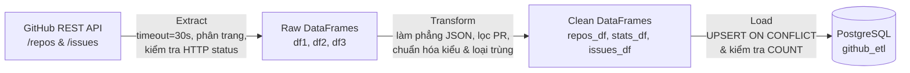
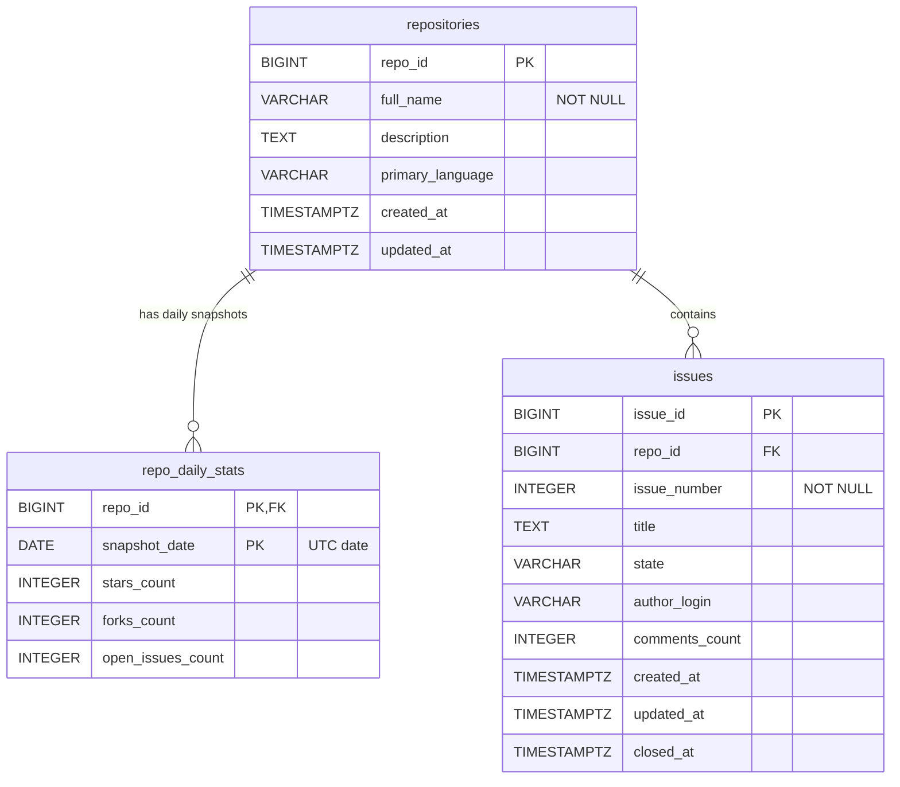

# Thiết kế hệ thống GitHub ETL Pipeline

## 1. Luồng xử lý ETL

## 2. Sơ đồ cơ sở dữ liệu (ERD)

## 3. Ghi chú thiết kế

- **Extract (`src/pipeline.py`):**
  - Gọi GitHub REST API với Bearer Token đọc từ biến môi trường `GITHUB_TOKEN`.
  - Áp dụng `timeout=30` cho mọi request để chống treo.
  - Phân biệt rõ các nhóm phản hồi HTTP: thành công (`2xx`), không tìm thấy repo (`404`), lỗi quyền truy cập / vượt rate limit (`401`, `403`, `429`), và lỗi server (`5xx`).
  - Phân trang tự động cho endpoint `/issues` và dừng khi trang trả về rỗng.
  - Ghi nhận `snapshot_date` theo ngày **UTC** (`datetime.now(timezone.utc).date()`) để đảm bảo tính nhất quán.

- **Transform (`src/pipeline.py`):**
  - Làm phẳng cấu trúc JSON lồng nhau bằng `pd.json_normalize(..., sep='_')`.
  - Lọc bỏ Pull Requests khỏi kết quả endpoint `/issues` (loại các bản ghi có trường `pull_request`).
  - Xử lý an toàn khi thiếu các trường tùy chọn (`description`, `language`, `user_login`).
  - Loại bỏ bản ghi thiếu khóa chính (`repo_id`, `issue_id`), `full_name` rỗng, số liệu âm (`< 0`), và loại trùng theo khóa chính.
  - Chuẩn hóa các cột thời gian sang `datetime`.

- **Load (`src/pipeline.py`):**
  - Sử dụng `DataFrame.to_sql(..., if_exists='append', method=_make_upsert_method(...))` để thực hiện **UPSERT** (`INSERT ... ON CONFLICT DO UPDATE`), đảm bảo pipeline có tính **idempotent** (chạy lại nhiều lần trong ngày không tạo bản ghi trùng mà cập nhật dữ liệu mới nhất).
  - Sau khi nạp, đọc lại `COUNT(*)` từ database cho cả 3 bảng để đối chiếu kết quả.

- **Logging & Error Isolation (`src/main.py`):**
  - Ghi log thời điểm bắt đầu, kết thúc và trạng thái thành công/thất bại cho từng repository và toàn bộ pipeline ra cả console lẫn file `etl.log`.
  - Nếu một repository gặp lỗi, pipeline ghi nhận lỗi và tiếp tục xử lý các repository còn lại.
